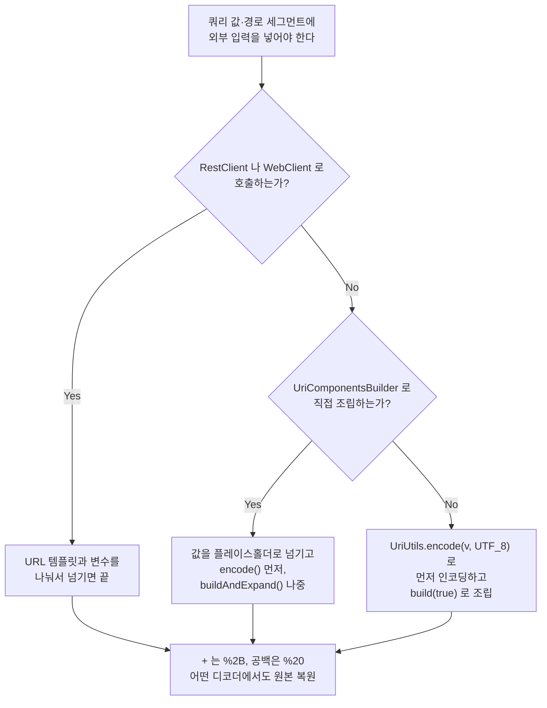

## 서론

서버 간 API 호출에서 쿼리 파라미터 값에 `+` 가 들어가 있으면 URL 인코딩은 어떻게 될까요?

실무에서 이 상황을 만났습니다. Spring 표준 도구인 `UriComponentsBuilder` 로 URL을 만들어 보냈는데, 수신 측 로그에는 `+` 가 **공백으로 바뀌어** 찍혀 있었습니다.

처음엔 제가 인코딩을 빠뜨린 줄 알았습니다. 그런데 소스를 따라가 보니 `UriComponentsBuilder` 는 제대로 동작하고 있었습니다. **RFC 3986을 충실히 따랐기 때문에** `+` 를 건드리지 않은 거였죠.

문제는 수신 측이 RFC 3986이 아닌 다른 표준으로 디코딩한다는 데 있었습니다. 그리고 그 "다른 표준"은 RFC 3986보다 10년 먼저 세상에 깔린 것이었습니다.

이 글은 그때 `UriComponentsBuilder` · `java.net.URLEncoder` · `UriUtils` 사이에서 고민했던 내용을 정리한 것입니다. 추측이 아니라 **Spring 6.2.8 + Java 25 환경에서 직접 실행한 결과**를 기준으로 삼았습니다.

## URL 퍼센트 인코딩이 왜 필요한가

URL은 그냥 문자열이 아니라 **구조를 가진 문자열**입니다. 몇몇 문자가 구조를 나누는 역할을 맡고 있습니다.

```text
https://api.example.com/search?q=spring&page=2#top
```

| 문자 | 역할 |
|---|---|
| `/` | 경로 구분 |
| `?` | 쿼리 시작 |
| `&` | 파라미터 구분 |
| `=` | 키와 값 구분 |
| `#` | 프래그먼트 시작 |

이 문자들이 구조를 결정하기 때문에 **값 안에 이런 문자가 들어가면 URL의 구조가 깨집니다.**

```text
검색어: a=1&b=2

그냥 붙이면   ?q=a=1&b=2          서버는 q, b 두 개의 파라미터로 읽는다
인코딩하면    ?q=a%3D1%26b%3D2     q 하나의 값으로 읽는다
```

퍼센트 인코딩은 이 문제를 해결하는 방법입니다. 문자를 UTF-8 바이트로 바꾸고 각 바이트를 `%` + 16진수 두 자리로 표현합니다. `=` 는 `%3D`, `&` 는 `%26`, 공백은 `%20` 이 됩니다. 이러면 구조를 나누는 문자와 값에 담긴 문자가 섞이지 않습니다.

여기까지는 간단합니다. 문제는 그 다음입니다.

> **어떤 문자를 인코딩해야 하는가?**

그런데 이 질문에는 답이 하나가 아닙니다. 어떤 도구는 `+` 를 인코딩하고 어떤 도구는 그냥 둡니다. 둘 다 각자의 근거가 있습니다. 이 글은 그 근거가 무엇이고, 그래서 어떤 도구를 골라야 하는지에 대한 이야기입니다.

## URL 인코딩 표준은 두 가지가 존재했다

Spring이 뭔가 잘못 만든 거라고 생각하면 이 동작은 끝까지 이해되지 않습니다. 원인은 Spring이 아니라 URL 인코딩에 서로 다른 **두 가지 표준**이 존재했고, 둘 다 아직 현역이라는 데 있습니다.

| 시점 | 표준 | 이 글과 관련된 내용 |
|---|---|---|
| 1994-12 | [RFC 1738](https://www.rfc-editor.org/rfc/rfc1738.txt) | URL 최초 표준. `~` 를 unsafe로 분류하고 반드시 인코딩하라고 규정 |
| 1995-11 | [RFC 1866](https://www.rfc-editor.org/rfc/rfc1866.txt) | HTML 2.0. `application/x-www-form-urlencoded` 등장. **공백을 `+` 로 치환** |
| 1998-08 | [RFC 2396](https://www.rfc-editor.org/rfc/rfc2396.txt) | URI 일반 문법. `~` 가 unreserved로 승격 |
| 2005-01 | [RFC 3986](https://www.rfc-editor.org/rfc/rfc3986.txt) | 현행 URI 표준. `+` 는 sub-delim이라 쿼리에서 합법 |

핵심은 **폼 인코딩이 10년 먼저 깔렸다**는 점입니다. RFC 1866의 원문은 이렇게 말합니다.

> The form field names and values are escaped: space characters are replaced by `+', and then reserved characters are escaped as per [URL]
>
> — RFC 1866, 8.2.1. The form-urlencoded Media Type

1995년에 HTML 폼이 이 방식을 쓰기 시작했고, 이후 10년간 웹 서버와 프레임워크들이 **쿼리 문자열 파서의 기본 동작**으로 이걸 구현했습니다. RFC 3986이 나온 건 2005년입니다. 문서상의 표준은 RFC 3986이지만, 실제로 깔려 있는 디팩토 표준은 1995년 폼 인코딩입니다. 지금도 [WHATWG URL Standard](https://url.spec.whatwg.org/#application/x-www-form-urlencoded)가 폼 인코딩을 따로 규정하고 있고 브라우저와 서버가 그걸 씁니다.

그래서 이런 역설이 생깁니다. **표준을 가장 충실히 따르는 도구가 현실에서 가장 잘 깨집니다.**

### RFC 3986의 문자 분류

RFC 3986은 URL에 쓰이는 문자를 몇 갈래로 나눕니다. 이 분류를 알면 도구들의 차이가 바로 설명됩니다.

| 분류 | 포함 문자 | 뜻 |
|---|---|---|
| `unreserved` | `A-Z` `a-z` `0-9` `-` `.` `_` `~` | 어디에 써도 안전한 문자. 인코딩할 이유가 없다 |
| `gen-delims` | `:` `/` `?` `#` `[` `]` `@` | URL의 큰 덩어리를 나누는 구분자 |
| `sub-delims` | `!` `$` `&` `'` `(` `)` `*` `+` `,` `;` `=` | 컴포넌트 안에서 구분자로 쓸 수 있도록 예약된 문자 |
| `pchar` | `unreserved` + `sub-delims` + `%XX` + `:` `@` | 경로 세그먼트 하나에 들어갈 수 있는 문자 |
| `query` | `pchar` + `/` + `?` | 쿼리 문자열에 쓸 수 있는 문자 |

`gen-delims` 와 `sub-delims` 를 합쳐 **reserved** 라고 부릅니다. 그런데 reserved는 "반드시 인코딩해야 한다"는 뜻이 아닙니다. **"구분자로 쓸 수 있게 예약돼 있다"는 뜻**입니다. 그래서 같은 문자가 구분자로 쓰일 수도 있고 값의 일부로 쓰일 수도 있습니다.

`pchar` 와 `query` 는 "어디에 쓸 수 있는 문자인지"를 정의한 집합입니다. 실제 URL에 대보면 쉽습니다.

```text
https://example.com/files/2026/report.pdf?tag=a+b&sort=date
```

| 부분 | 적용되는 집합 |
|---|---|
| `files` · `2026` · `report.pdf` | 각각 하나의 **경로 세그먼트**. 세그먼트 안에 들어갈 수 있는 문자가 `pchar` |
| `tag=a+b&sort=date` | **쿼리** 전체. `pchar` 에 `/` 와 `?` 를 더한 집합이 허용된다 |

두 집합의 차이를 보면 규칙이 왜 이렇게 생겼는지 보입니다.

- **`pchar` 에 `/` 가 없는 이유**: `/` 는 세그먼트를 나누는 문자입니다. 세그먼트 *안*에 들어가면 조각이 하나 더 생겨 버리니 들어갈 수 없습니다. 파일명에 `/` 가 필요하면 `%2F` 로 인코딩해야 합니다.
- **`query` 가 `pchar` 보다 넓은 이유**: 쿼리 안에서는 `/` 와 `?` 가 더 이상 구조적 의미를 갖지 않습니다. `?q=a/b?c` 는 합법적인 URL입니다.

바로 여기서 이 글의 문제가 나옵니다.

```text
query = *( pchar / "/" / "?" )
pchar = unreserved / pct-encoded / sub-delims / ":" / "@"
```

`+` 는 `sub-delims` 에 속하고, `sub-delims` 는 `pchar` 에 포함되며, `query` 는 `pchar` 를 허용합니다. 즉 쿼리에 `+` 가 날것으로 들어 있어도 **RFC 3986 입장에서는 완벽히 합법**입니다.

게다가 인코더는 그 문자가 구분자로 쓰인 건지 값의 일부인지 **알 수 없습니다.** 완성된 문자열만 받아서는 구별할 방법이 없으니까요. 그래서 "각 컴포넌트에서 허용되지 않는 문자만 인코딩한다"는 정책을 가진 인코더는 `+` 를 건드리지 않습니다. 허용되는 문자니까요.

그리고 폼 디코더는 그 `+` 를 공백으로 읽습니다. 양쪽 다 자기 표준에는 맞습니다.

### 공백은 어느 분류에도 없다

위 분류를 다시 보면 한 가지가 빠져 있습니다. **공백이 없습니다.** 실수로 뺀 게 아니라 정말로 없습니다. RFC 3986의 문법 어디에도 공백이 등장하지 않습니다. 즉 **공백은 URL에 쓸 수 없는 문자**입니다.

RFC 3986은 퍼센트 인코딩을 설명할 때 공백을 바로 그 예로 듭니다.

> A percent-encoding mechanism is used to represent a data octet in a component when that octet's corresponding character is **outside the allowed set** (...) For example, "%20" is the percent-encoding for the binary octet "00100000" (ABNF: %x20), which in US-ASCII corresponds to the space character (SP).
>
> — RFC 3986, 2.1. Percent-Encoding

이 차이가 다음 절의 실측 표를 전부 설명해 줍니다.

| 문자 | RFC 3986에서의 위치 | 인코딩 의무 | 그래서 |
|---|---|---|---|
| 공백 | 허용 집합 **밖** | 반드시 인코딩해야 한다 | 모든 도구가 인코딩한다 (RFC 계열은 `%20`, 폼 계열은 `+`) |
| `+` | `sub-delims`, 허용 집합 **안** | 의무가 없다 | 도구의 정책에 따라 갈린다 |

공백은 선택의 여지가 없으니 모든 도구가 같은 일을 합니다. `+` 는 의무가 없으니 도구마다 다른 선택을 합니다. **세 도구가 왜 다르게 동작하는지는 결국 이 차이로 요약됩니다.**

## 세 도구는 어떻게 다른가

문서만 읽고 추론하면 틀립니다. 직접 실행했습니다. (Spring Framework 6.2.8 / OpenJDK 25.0.5 Temurin)

| 입력 | `URLEncoder` | `UriUtils.encode` | `encodeQueryParam` | `UCB` 값 직접 | `UCB` 변수로 |
|---|---|---|---|---|---|
| `+` | `%2B` | `%2B` | `+` | `+` | `%2B` |
| 공백 | `+` | `%20` | `%20` | `%20` | `%20` |
| `a+b c` | `a%2Bb+c` | `a%2Bb%20c` | `a+b%20c` | `a+b%20c` | `a%2Bb%20c` |
| `a+b&c d` | `a%2Bb%26c+d` | `a%2Bb%26c%20d` | `a+b%26c%20d` | `a+b%26c%20d` | `a%2Bb%26c%20d` |
| `%20` | `%2520` | `%2520` | `%2520` | `%2520` | `%2520` |
| `~` | `%7E` | `~` | `~` | `~` | `~` |
| `*` | `*` | `%2A` | `*` | `*` | `%2A` |
| `;` | `%3B` | `%3B` | `;` | `;` | `%3B` |
| `=` | `%3D` | `%3D` | `%3D` | `%3D` | `%3D` |
| 한글 | `%ED%95%9C%EA%B8%80` | 왼쪽과 같음 | 왼쪽과 같음 | 왼쪽과 같음 | 왼쪽과 같음 |

`UCB` 는 `UriComponentsBuilder` 입니다. "값 직접"은 `queryParam("foo", 값)`, "변수로"는 `queryParam("foo", "{v}")` 뒤에 `encode().buildAndExpand(값)` 을 쓴 경우입니다.

표에서 바로 읽히는 것들입니다.

- `URLEncoder` 는 `+` 를 `%2B` 로 바꿔 주지만 **공백을 `+` 로 바꿉니다.**
- `UriUtils.encode` 만 `+` → `%2B`, 공백 → `%20` 을 동시에 만족합니다.
- `encodeQueryParam` 과 `UriComponentsBuilder` 는 `+` 를 그대로 둡니다.
- 같은 `UriComponentsBuilder` 인데 **값을 변수로 넘기면 `%2B` 가 나옵니다.** 따로 다룰 가치가 있는 비대칭입니다.
- `*` 는 `URLEncoder` 가 손대지 않고 `UriUtils.encode` 가 `%2A` 로 바꿉니다. "URLEncoder가 가장 보수적"이라는 통념의 반례입니다.
- `%20` 을 넣으면 넷 다 `%2520` 을 만듭니다. **이중 인코딩을 막아 주는 도구는 없습니다.**

### 중요한 건 인코딩 결과가 아니라 복원 결과다

어느 쪽이 맞다고 말하려면 수신 측에서 원본이 복원되는지를 봐야 합니다. 같은 값을 두 방식으로 인코딩하고 두 종류의 디코더로 각각 풀어 봤습니다.

| 인코딩 | 결과 | `URLDecoder` (폼) | `UriUtils.decode` (RFC 3986) |
|---|---|---|---|
| `URLEncoder` | `a%2Bb+c` | `a+b c` 복원됨 | `a+b+c` **깨짐** |
| `UriUtils.encode` | `a%2Bb%20c` | `a+b c` 복원됨 | `a+b c` 복원됨 |

`URLEncoder` 의 출력은 **수신 측이 폼 디코더일 때만** 원본으로 돌아옵니다. RFC 3986 디코더를 쓰는 상대에게 보내면 공백이 `+` 로 변해 도착합니다.

`UriUtils.encode` 의 출력은 양쪽 모두에서 복원됩니다. `%2B` 와 `%20` 은 두 표준이 해석을 공유하는 표현이기 때문입니다. 공백을 `+` 로 쓰거나 `+` 를 날것으로 두는 순간 해석이 갈리지만, 퍼센트 인코딩된 옥텟은 갈리지 않습니다.

## 왜 다르게 동작하는가

차이는 각 도구가 **다른 표준을 구현했거나, 같은 표준을 다른 범위로 적용**하기 때문입니다.

| 도구 | 따르는 표준 | 인코딩 범위 |
|---|---|---|
| [`URLEncoder`](https://docs.oracle.com/en/java/javase/25/docs/api/java.base/java/net/URLEncoder.html) | `x-www-form-urlencoded` (폼) | 영숫자와 `.` `-` `*` `_` 외 전부. 공백은 `+` |
| [`UriUtils.encode`](https://docs.spring.io/spring-framework/docs/current/javadoc-api/org/springframework/web/util/UriUtils.html) | RFC 3986 | **unreserved만** 남기고 전부 |
| `UriUtils.encodeQueryParam` | RFC 3986 | 쿼리에서 허용되지 않는 문자만 (여기에 `=` `&` 추가) |
| [`UriComponentsBuilder`](https://docs.spring.io/spring-framework/docs/current/javadoc-api/org/springframework/web/util/UriComponentsBuilder.html) | RFC 3986 | 컴포넌트별로 허용되지 않는 문자만. 단 URI 변수는 예외 |

`URLEncoder` 가 RFC 3986의 구현이 아니라는 점이 핵심입니다. Javadoc이 밝히듯 이 클래스는 **HTML 폼 표준의 구현**입니다. 그래서 공백이 `+` 가 되고, URL의 경로 부분에는 쓸 수 없습니다. 경로에서 `+` 는 공백이 아니라 그냥 `+` 니까요.

Spring 쪽은 모두 RFC 3986을 따르지만 적용 범위가 다릅니다. [`HierarchicalUriComponents.Type`](https://github.com/spring-projects/spring-framework/blob/main/spring-web/src/main/java/org/springframework/web/util/HierarchicalUriComponents.java) 열거형이 컴포넌트별 허용 문자를 정의합니다.

```java
QUERY_PARAM {
    @Override
    public boolean isAllowed(int c) {
        if ('=' == c || '&' == c) {
            return false;
        }
        else {
            return (isPchar(c) || '/' == c || '?' == c);
        }
    }
},
// ...
URI {
    @Override
    public boolean isAllowed(int c) {
        return isUnreserved(c);
    }
};
```

`QUERY_PARAM` 은 파라미터 경계를 깨뜨리는 `=` 와 `&` 만 막고 나머지는 `isPchar` 에 맡깁니다. `+` 는 sub-delim이라 통과합니다. 반면 `URI` 타입은 **unreserved만** 허용합니다. `UriUtils.encode` 가 쓰는 게 이 `URI` 타입이고, 그래서 세 도구 중 가장 엄격합니다.

## UriComponentsBuilder의 두 가지 비대칭

`UriComponentsBuilder` 가 유독 혼란스러운 건 `+` 를 인코딩하지 않는다는 사실 자체가 아닙니다. **같은 값이 어디에, 어떻게 들어가는지에 따라 결과가 달라진다**는 점입니다.

### 1. 값을 직접 넣느냐, URI 변수로 넘기느냐

```java
String value = "a+b c";

// (1) 값을 직접 박고 encode()
UriComponentsBuilder.fromUriString("https://example.com/api")
        .queryParam("foo", value)
        .encode()
        .build()
        .toUriString();
// -> ...?foo=a+b%20c       '+' 그대로

// (2) 값을 URI 변수로 넘기고 encode()
UriComponentsBuilder.fromUriString("https://example.com/api")
        .queryParam("foo", "{v}")
        .encode()
        .buildAndExpand(value)
        .toUriString();
// -> ...?foo=a%2Bb%20c     '+' -> %2B
```

같은 값, 같은 `encode()` 호출인데 결과가 다릅니다. 버그가 아니라 문서화된 설계입니다. `UriComponentsBuilder.encode()` 의 Javadoc이 직접 설명합니다.

> each URI component is encoded by replacing non-ASCII and illegal (within the URI component type) characters with escaped octets. **However URI variables are encoded more strictly, by also escaping characters with reserved meaning.**

`+` 는 reserved(sub-delim)입니다. 그래서 URI **변수**로 넘긴 값에서는 인코딩되고, 템플릿에 직접 박힌 리터럴에서는 인코딩되지 않습니다.

Spring 웹 모듈을 이끄는 Rossen Stoyanchev가 관련 이슈([#23148](https://github.com/spring-projects/spring-framework/issues/23148))를 닫으며 남긴 설명도 같습니다.

> Only URI variables are strongly encoded (i.e. all reserved characters). The literal parts of the URI template are simply checked for allowed characters per URI component.

함정은 `queryParam("foo", value)` 가 **직관적으로는 "값을 넘기는" 코드처럼 보인다**는 데 있습니다. Spring 입장에서 그 값은 URI 템플릿의 리터럴 일부입니다. 변수 대접을 받으려면 `{v}` 플레이스홀더를 거쳐야 합니다.

`encode()` 의 **호출 위치**도 같은 함정을 만듭니다.

```java
builder.buildAndExpand(value).encode();   // 변수를 먼저 펼침 -> '+' 그대로
builder.encode().buildAndExpand(value);   // 인코딩을 먼저 걸음 -> '+' -> %2B
```

### 2. path냐 query냐

두 번째 비대칭은 컴포넌트에 따라 같은 문자의 처리가 달라진다는 점입니다.

| 입력 | path (값 직접) | path (변수로) | query (값 직접) | query (변수로) |
|---|---|---|---|---|
| `+` | `/+` | `/%2B` | `+` | `%2B` |
| `&` | `/&` | `/%26` | `%26` | `%26` |
| `=` | `/=` | `/%3D` | `%3D` | `%3D` |
| `?` | `/%3F` | `/%3F` | `?` | `%3F` |
| `/` | `/` | `/%2F` | `/` | `%2F` |
| `;` | `/;` | `/%3B` | `;` | `%3B` |

`?` 는 path에서 `%3F` 로 바뀌지만 query에서는 통과합니다. `&` 와 `=` 는 정반대입니다. 컴포넌트마다 구조를 깨뜨리는 문자가 다르니 표준상으로는 일관된 동작인데, 쓰는 사람 입장에서는 외울 수 없는 표가 됩니다.

특히 `/` 행을 보세요. 값으로 `/` 를 path에 넣으면 인코딩되지 않고 **그대로 경로 구분자가 됩니다.** 값 하나가 URL의 구조를 바꿔 버리니, 경로에 외부 입력을 넣을 때는 반드시 URI 변수로 넘기거나 `UriUtils.encodePathSegment` 를 거쳐야 합니다.

## HTTP 클라이언트에 따라 기본값이 다르다

한 겹이 더 있습니다. Spring의 HTTP 클라이언트들은 내부적으로 `DefaultUriBuilderFactory` 를 쓰는데, **클라이언트마다 기본 모드가 다릅니다.** 로컬 HTTP 서버를 띄워 같은 값을 보내고 서버가 받은 raw query를 그대로 찍어 봤습니다.

| 클라이언트 | 기본 [`EncodingMode`](https://docs.spring.io/spring-framework/docs/current/javadoc-api/org/springframework/web/util/DefaultUriBuilderFactory.EncodingMode.html) | 서버가 받은 값 |
|---|---|---|
| [`RestClient`](https://docs.spring.io/spring-framework/reference/integration/rest-clients.html#rest-restclient) | `TEMPLATE_AND_VALUES` | `foo=a%2Bb%20c` |
| `WebClient` | `TEMPLATE_AND_VALUES` | `foo=a%2Bb%20c` |
| `RestTemplate` | `URI_COMPONENT` | `foo=a+b%20c` **깨짐** |

```java
restClient.get().uri(base + "/api?foo={v}", "a+b c").retrieve().body(String.class);
// 서버가 받은 값: foo=a%2Bb%20c
```

`RestClient` 와 `WebClient` 는 `DefaultUriBuilderFactory` 의 클래스 기본값인 `TEMPLATE_AND_VALUES` 를 그대로 씁니다. **템플릿과 변수를 나눠 넘기기만 하면 앞 절의 비대칭을 신경 쓸 필요가 없습니다.** 변수에 엄격한 인코딩이 자동으로 걸리니까요.

`RestTemplate` 만 다릅니다. 생성자에서 하위 호환을 위해 `URI_COMPONENT` 로 덮어쓰기 때문에, 템플릿과 변수를 올바르게 나눠 넘겨도 `+` 가 그대로 나갑니다. 레거시 코드에서 이 문제를 만났다면 `setUriTemplateHandler` 로 모드를 바꾸거나 `RestClient` 로 옮기면 됩니다.

## 결론: UriUtils.encode(), 그리고 같은 클래스의 함정

정리하면 직접 인코딩할 때의 선택은 `UriUtils.encode(value, UTF_8)` 입니다. `+` 를 `%2B` 로, 공백을 `%20` 으로 만들어서 **수신 측 디코더가 무엇이든 원본이 복원되는 유일한 선택**이기 때문입니다.

그런데 실수하기 쉬운 함정이 하나 있습니다. **같은 클래스의 다른 메서드들은 전부 느슨합니다.**

| 입력 | `encode` | `encodePath` | `encodePathSegment` | `encodeQueryParam` | `encodeFragment` |
|---|---|---|---|---|---|
| `a+b c` | `a%2Bb%20c` | `a+b%20c` | `a+b%20c` | `a+b%20c` | `a+b%20c` |
| `*` | `%2A` | `*` | `*` | `*` | `*` |
| `;` | `%3B` | `;` | `;` | `;` | `;` |

`UriUtils` 에는 컴포넌트별 메서드가 친절하게 준비돼 있습니다. 쿼리 파라미터 값을 인코딩하려면 `encodeQueryParam` 을 고르는 게 자연스럽죠. **그런데 바로 그 선택이 함정입니다.** `encodeQueryParam` 은 `Type.QUERY_PARAM` 을 쓰니 `+` 를 통과시킵니다.

`encode(String, Charset)` 만 `Type.URI` 를 쓰고, `Type.URI` 는 unreserved만 허용합니다. Javadoc의 설명이 의도를 분명히 합니다.

> Encode all characters that are either illegal, or have any reserved meaning, anywhere within a URI, as defined in RFC 3986. This is useful to ensure that the given String will be preserved as-is and will not have any impact on the structure or meaning of the URI.

"UriUtils를 쓰면 안전하다"가 아니라 **`UriUtils.encode()` 를 써야 안전합니다.**

### `~` 를 그대로 두는 건 올바른 동작이다

실측 표에서 `UriUtils.encode` 가 `~` 를 남긴 걸 보면 이 도구도 느슨한 게 아닌지 의심이 들 수 있습니다. 반대입니다. **그게 RFC 3986이 요구하는 동작입니다.**

> URIs that differ in the replacement of an unreserved character with its corresponding percent-encoded US-ASCII octet are equivalent: they identify the same resource. (...) percent-encoded octets in the ranges of ALPHA, DIGIT, hyphen, period, underscore, or tilde (%7E) **should not be created by URI producers**
>
> — RFC 3986, 2.3. Unreserved Characters

`~` 와 `%7E` 는 표준상 같은 URI이고, 표준은 더 나아가 `%7E` 를 만들지 말라고 합니다. `~` 를 남기는 `UriUtils.encode` 가 표준을 지키는 쪽이고, `%7E` 를 만드는 `URLEncoder` 가 SHOULD NOT을 어기는 쪽입니다. `URLEncoder` 가 그렇게 동작하는 건 1994년 RFC 1738이 `~` 를 unsafe로 분류했던 시절의 유산입니다.

의미상 둘이 동등하니 실무에서 문제가 되는 일은 드뭅니다. 다만 **URL을 바이트 단위로 비교하는 곳**에서는 다릅니다. 요청 서명(HMAC) 계산, 캐시 키, 로그 매칭 같은 데서는 두 표현이 서로 다른 문자열입니다.

## 선택 가이드



실무 규칙으로 압축하면 이렇습니다.

1. **`RestClient` 나 `WebClient` 를 쓴다면** URL 템플릿과 변수를 나눠 넘기는 정석 호출만으로 충분합니다. 값을 문자열 연결로 붙이지만 마세요.
2. **`UriComponentsBuilder` 로 직접 조립한다면** 값을 `queryParam("k", v)` 로 박지 말고 `{v}` 플레이스홀더로 넘기고, `encode()` 를 `buildAndExpand()` 보다 먼저 호출합니다.
3. **값만 따로 인코딩해야 한다면** `UriUtils.encode(value, UTF_8)` 를 쓰고 `build(true)` 로 조립합니다. 같은 클래스의 `encodeQueryParam` 이 아니라 `encode` 입니다.
4. **`URLEncoder` 는 URL에 쓰지 않습니다.** 폼 바디를 손으로 만드는 경우가 아니라면 맞지 않습니다.
5. **인코딩 책임은 한 곳에만 둡니다.** 어떤 도구도 이중 인코딩을 막아 주지 않습니다. `%20` 을 다시 인코딩하면 `%2520` 이 됩니다.

레거시 코드에서 `RestTemplate` 을 쓰고 있다면 2·3번이 아니라 `EncodingMode` 부터 확인하세요. 기본값이 하위 호환 모드라 템플릿과 변수를 올바르게 나눠 넘겨도 `+` 가 빠져나갑니다.

마지막으로 덧붙이면, `+` 인코딩을 지적하는 이슈가 Spring 트래커에 [2012년](https://github.com/spring-projects/spring-framework/issues/14464)부터 [2019년](https://github.com/spring-projects/spring-framework/issues/23148)까지 반복해서 올라왔고 전부 닫혔습니다. 버그가 아니라 표준 해석의 차이이기 때문입니다.

그러니 "Spring이 왜 이렇게 만들었나"를 묻는 대신, **내가 보내는 URL을 상대가 어떤 표준으로 읽을 것인가**를 먼저 확인하는 편이 빠릅니다.

## 참고 자료

- [RFC 3986 — Uniform Resource Identifier (URI): Generic Syntax](https://www.rfc-editor.org/rfc/rfc3986.txt)
- [RFC 1866 — HTML 2.0, 8.2.1 The form-urlencoded Media Type](https://www.rfc-editor.org/rfc/rfc1866.txt)
- [WHATWG URL Standard — application/x-www-form-urlencoded](https://url.spec.whatwg.org/#application/x-www-form-urlencoded)
- [Spring Framework Reference — REST Clients](https://docs.spring.io/spring-framework/reference/integration/rest-clients.html)
- [Spring Framework Reference — URI Links](https://docs.spring.io/spring-framework/reference/web/webmvc/mvc-uri-building.html)
- [HierarchicalUriComponents 소스](https://github.com/spring-projects/spring-framework/blob/main/spring-web/src/main/java/org/springframework/web/util/HierarchicalUriComponents.java)
- [Jim Rennie — Spring's UriComponentsBuilder encoding](https://blog.jimrennie.com/2020-04-01-uri-components-builder-encoding) — 같은 문제를 Spring 5 시절에 정리한 글. 결론도 "`UriUtils` 가 가장 일관적이며 쿼리 파라미터를 인코딩하는 가장 안전한 방법"으로 같다
