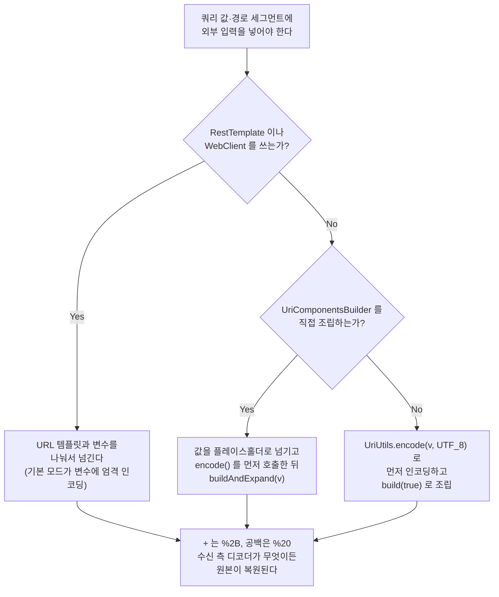

## 서론

서버 간 API 호출에서 쿼리 파라미터 값에 `+` 가 포함되어 있었습니다. Spring 표준 도구인 `UriComponentsBuilder` 로 URL을 만들어 보냈는데, 수신 측 로그를 보니 `+` 가 **공백으로 바뀌어 도착**해 있었습니다.

처음에는 제 실수라고 생각했습니다. 인코딩을 깜빡했거나, 호출 순서를 잘못 썼거나. 하지만 소스 코드를 따라가 보니 `UriComponentsBuilder` 는 의도대로 동작하고 있었습니다. **RFC 3986을 충실히 따르고 있었기 때문에** `+` 를 그대로 둔 것이었습니다.

문제는 수신 측이 RFC 3986이 아닌 다른 규격으로 디코딩한다는 점이었습니다. 그리고 그 "다른 규격"은 RFC 3986보다 10년 먼저 세상에 깔린 것이었습니다.

이 글에서는 `UriComponentsBuilder` · `java.net.URLEncoder` · `UriUtils` 세 도구의 동작을 **Spring 6.2.8 + Java 25 환경에서 직접 실행해 비교**하고, 왜 "표준을 가장 잘 따르는 도구"가 실무에서 깨지는지, 그리고 수신 측 디코더가 무엇이든 안전한 선택이 무엇인지 정리합니다.

## 문제의 뿌리: 표준이 두 겹으로 깔려 있다

이 문제를 "Spring의 버그"로 이해하면 영원히 헷갈립니다. 원인은 URL 인코딩에 **서로 다른 두 규격**이 존재하고, 둘 다 현역이라는 데 있습니다.

| 시점 | 규격 | 이 글과 관련된 내용 |
|---|---|---|
| 1994-12 | RFC 1738 | URL의 최초 규격. `~` 를 **unsafe** 로 분류하고 "반드시 인코딩" 하라고 명시 |
| 1995-11 | RFC 1866 (HTML 2.0) | `application/x-www-form-urlencoded` 등장. **공백을 `+` 로 치환** |
| 1998-08 | RFC 2396 | URI 일반 문법. `~` 가 `mark` 에 편입되어 unreserved 가 됨 |
| 2005-01 | RFC 3986 | 현행 URI 규격. `+` 는 **sub-delim** 이라 쿼리에서 합법. `~` 는 unreserved이고 `%7E` 를 **만들지 말라고** 명시 |

핵심은 **폼 인코딩이 10년 먼저 깔렸다**는 점입니다. RFC 1866의 원문은 이렇게 말합니다.

> The form field names and values are escaped: space characters are replaced by `+', and then reserved characters are escaped as per [URL]
>
> — RFC 1866, 8.2.1. The form-urlencoded Media Type

1995년에 HTML 폼이 이 방식을 채택했고, 그 뒤 10년간 모든 웹 서버와 웹 프레임워크가 **쿼리 문자열 파서의 기본값**으로 이것을 구현했습니다. RFC 3986은 2005년에 나왔습니다. 규격상의 표준은 RFC 3986이지만, 실제로 깔려 있는 디팩토 표준은 1995년 폼 인코딩입니다.

그래서 이런 역설이 생깁니다. **표준을 가장 충실히 따르는 도구가 현실에서 가장 잘 깨집니다.**

### RFC 3986이 `+` 를 건드리지 않는 이유

RFC 3986에서 쿼리 컴포넌트에 허용되는 문자 집합을 보면 `+` 가 포함되어 있습니다.

```text
unreserved  = ALPHA / DIGIT / "-" / "." / "_" / "~"
sub-delims  = "!" / "$" / "&" / "'" / "(" / ")"
            / "*" / "+" / "," / ";" / "="
pchar       = unreserved / pct-encoded / sub-delims / ":" / "@"
query       = *( pchar / "/" / "?" )
```

`+` 는 `sub-delims` 에 속하고, `sub-delims` 는 `pchar` 에 포함되며, `query` 는 `pchar` 를 허용합니다. 즉 **쿼리 문자열에 `+` 가 날것으로 들어가 있어도 RFC 3986 입장에서는 완벽히 합법**입니다. "컴포넌트별로 불법 문자만 인코딩한다"는 정책을 가진 인코더는 당연히 `+` 를 그대로 둡니다.

Spring의 구현에서도 이 판정을 그대로 확인할 수 있습니다. `HierarchicalUriComponents.Type` 열거형이 컴포넌트별 허용 문자를 정의합니다.

```java
QUERY_PARAM {
    @Override
    public boolean isAllowed(int c) {
        if ('=' == c || '&' == c) {
            return false;
        }
        else {
            return (isPchar(c) || '/' == c || '?' == c);
        }
    }
},
// ...
URI {
    @Override
    public boolean isAllowed(int c) {
        return isUnreserved(c);
    }
};
```

`QUERY_PARAM` 은 파라미터 경계를 깨뜨리는 `=` 와 `&` 만 예외로 막고, 나머지는 `isPchar` 에 맡깁니다. `+` 는 sub-delim이므로 `isPchar` 를 통과합니다. 반면 맨 아래 `URI` 타입은 **unreserved만** 허용합니다. 이 차이가 이 글의 결론으로 이어집니다.

## 세 도구의 실측 비교

문서만 읽고 추론하면 틀립니다. 직접 실행했습니다.

- Spring Framework 6.2.8
- OpenJDK 25.0.5 (Temurin 25.0.5+8)

```text
입력      | URLEncoder | UriUtils.encode | encodeQueryParam | UCB(값직접) | UCB({변수})
"+"       | %2B        | %2B             | +                | +           | %2B
" "       | +          | %20             | %20              | %20         | %20
"a+b c"   | a%2Bb+c    | a%2Bb%20c       | a+b%20c          | a+b%20c     | a%2Bb%20c
"a+b&c d" | a%2Bb%26c+d| a%2Bb%26c%20d   | a+b%26c%20d      | a+b%26c%20d | a%2Bb%26c%20d
"%20"     | %2520      | %2520           | %2520            | %2520       | %2520
"~"       | %7E        | ~               | ~                | ~           | ~
"*"       | *          | %2A             | *                | *           | %2A
";"       | %3B        | %3B             | ;                | ;           | %3B
","       | %2C        | %2C             | ,                | ,           | %2C
"="       | %3D        | %3D             | %3D              | %3D         | %3D
"&"       | %26        | %26             | %26              | %26         | %26
"한글"    | %ED%95%9C%EA%B8%80 (네 도구 모두 동일)
```

표에서 바로 읽히는 사실들입니다.

- `URLEncoder` 는 `+` 를 `%2B` 로 바꿔 주지만, **공백을 `+` 로 바꿉니다.**
- `UriUtils.encode` 만 `+` → `%2B`, 공백 → `%20` 을 동시에 만족합니다.
- `UriUtils.encodeQueryParam` 과 `UriComponentsBuilder` 는 `+` 를 그대로 둡니다.
- 마지막 열, **값을 URI 변수로 넘기면 같은 `UriComponentsBuilder` 인데도 `%2B` 가 나옵니다.** 이 비대칭은 따로 다룰 가치가 있습니다.
- `"%20"` 을 입력하면 네 도구 모두 `%2520` 을 만듭니다. **이중 인코딩을 막아 주는 도구는 없습니다.** 인코딩 책임은 정확히 한 곳에만 두어야 합니다.

## 왕복 검증: 수신 측 디코더가 다를 때

인코딩 결과표만으로는 "어느 쪽이 맞다"고 말할 수 없습니다. 중요한 것은 **수신 측이 디코딩했을 때 원본이 복원되는가**입니다. 같은 값을 두 방식으로 인코딩하고, 두 종류의 디코더로 각각 풀어 봤습니다.

```text
원본 "a+b c"

URLEncoder      -> a%2Bb+c
   URLDecoder      로 복호 : "a+b c"   OK
   UriUtils.decode 로 복호 : "a+b+c"   깨짐 — 공백이 +로

UriUtils.encode -> a%2Bb%20c
   URLDecoder      로 복호 : "a+b c"   OK
   UriUtils.decode 로 복호 : "a+b c"   OK
```

결과가 선명합니다. `URLEncoder` 의 출력은 **수신 측이 폼 디코더일 때만** 원본으로 돌아옵니다. RFC 3986 디코더를 쓰는 상대에게 보내면 공백이 `+` 로 변해서 도착합니다.

반면 `UriUtils.encode` 의 출력은 **양쪽 디코더에서 모두 원본으로 복원**됩니다. `%2B` 와 `%20` 은 두 규격이 해석을 공유하는 표현이기 때문입니다. 공백을 `+` 로 쓰거나 `+` 를 날것으로 두는 순간 규격 간 해석이 갈리지만, 퍼센트 인코딩된 옥텟은 갈리지 않습니다.

이 지점이 처음에 제가 "멱등성 문제"라고 잘못 이해했던 부분입니다. 정확한 이름은 멱등성이 아니라 **수신 측 디코더와의 비대칭** 입니다. 멱등성으로 따지면 두 도구 모두 실패합니다. 앞의 표에서 봤듯이 `%20` 을 다시 인코딩하면 `%2520` 이 되니까요.

## UriComponentsBuilder의 두 가지 비대칭

`UriComponentsBuilder` 가 혼란스러운 이유는 `+` 를 인코딩하지 않는다는 사실 자체가 아닙니다. **같은 값이 어디에 들어가는지, 어떻게 전달되는지에 따라 결과가 달라진다**는 점입니다.

### 1. 값을 직접 넣느냐, URI 변수로 넘기느냐

```java
String value = "a+b c";

// (1) 값을 직접 박고 encode()
UriComponentsBuilder.fromUriString("https://example.com/api")
        .queryParam("foo", value)
        .encode()
        .build()
        .toUriString();
// -> https://example.com/api?foo=a+b%20c       '+' 그대로

// (2) 값을 URI 변수로 넘기고 encode()
UriComponentsBuilder.fromUriString("https://example.com/api")
        .queryParam("foo", "{v}")
        .encode()
        .buildAndExpand(value)
        .toUriString();
// -> https://example.com/api?foo=a%2Bb%20c     '+' -> %2B
```

같은 값, 같은 `encode()` 호출인데 결과가 다릅니다. 이것은 버그가 아니라 **문서화된 설계**입니다. `UriComponentsBuilder.encode()` 의 Javadoc이 직접 설명합니다.

> In comparison to `UriComponents#encode()`, this method has the same effect on the URI template, i.e. each URI component is encoded by replacing non-ASCII and illegal (within the URI component type) characters with escaped octets. **However URI variables are encoded more strictly, by also escaping characters with reserved meaning.**

`+` 는 reserved(sub-delim)입니다. 그래서 URI **변수**로 넘긴 값에서는 인코딩되고, 템플릿에 직접 박힌 리터럴에서는 인코딩되지 않습니다.

Spring Framework 웹 모듈 리드인 Rossen Stoyanchev가 관련 이슈([#23148](https://github.com/spring-projects/spring-framework/issues/23148))를 닫으면서 남긴 설명도 같습니다.

> Only URI variables are strongly encoded (i.e. all reserved characters). The literal parts of the URI template are simply checked for allowed characters per URI component.

여기서 함정은 `queryParam("foo", value)` 가 **직관적으로는 "값을 넘기는" 코드처럼 보인다**는 점입니다. 하지만 Spring 입장에서 그 값은 URI 템플릿의 리터럴 일부가 됩니다. 변수 취급을 받으려면 `{v}` 플레이스홀더를 거쳐야 합니다.

`encode()` 의 **호출 위치**도 같은 함정을 만듭니다.

```java
// 변수를 먼저 펼치고 나서 인코딩 -> 느슨한 컴포넌트 인코딩
builder.buildAndExpand(value).encode();   // '+' 그대로

// 인코딩을 먼저 걸고 변수를 펼침 -> 변수에 엄격한 인코딩
builder.encode().buildAndExpand(value);   // '+' -> %2B
```

참고로 `RestTemplate` 과 `WebClient` 가 내부적으로 쓰는 `DefaultUriBuilderFactory` 의 기본 모드는 `EncodingMode.TEMPLATE_AND_VALUES` 입니다. 그래서 **URL 템플릿과 변수를 나눠서 넘기는 정석적인 호출**은 기본적으로 `%2B` 로 나갑니다.

```java
// 변수로 넘기므로 엄격한 인코딩 적용
restTemplate.getForObject("https://example.com/api?foo={v}", String.class, "a+b c");
```

### 2. path냐 query냐

두 번째 비대칭은 컴포넌트에 따라 같은 문자의 처리가 달라진다는 점입니다.

```text
입력    | path(값직접) | path({변수}) | query(값직접) | query({변수})
"+"     | /+          | /%2B        | +            | %2B
"&"     | /&          | /%26        | %26          | %26
"="     | /=          | /%3D        | %3D          | %3D
"?"     | /%3F        | /%3F        | ?            | %3F
"/"     | /           | /%2F        | /            | %2F
";"     | /;          | /%3B        | ;            | %3B
```

`?` 는 path에서는 `%3F` 로 인코딩되지만 query에서는 통과합니다. `&` 와 `=` 는 정반대입니다. 각 컴포넌트에서 "구조를 깨뜨리는 문자"가 다르기 때문에 규격상으로는 일관된 동작이지만, 쓰는 사람 입장에서는 외울 수 없는 표가 됩니다.

특히 `"/"` 행을 보십시오. 값으로 `/` 를 path에 넣으면 **인코딩되지 않고 그대로 경로 구분자가 됩니다.** 값 하나가 URL의 구조를 바꿔 버립니다.

```java
// 사용자 입력이 경로를 쪼갠다
UriComponentsBuilder.fromUriString("https://example.com")
        .path("/" + userInput)   // userInput = "a/../admin"
        .encode().build().getPath();
// -> /a/../admin
```

경로 세그먼트에 외부 입력을 넣을 때는 반드시 URI 변수로 넘기거나 `UriUtils.encodePathSegment` 를 거쳐야 합니다.

## URLEncoder를 쓸 수 없는 이유

`+` 를 `%2B` 로 만들어 주니 `java.net.URLEncoder` 가 답인 것처럼 보입니다. 하지만 이 클래스는 **RFC 3986의 구현이 아닙니다.** Javadoc이 밝히듯 `application/x-www-form-urlencoded` 즉 HTML 폼 규격의 구현입니다.

그래서 공백을 `+` 로 바꿉니다. 결과는 앞의 왕복 검증에서 본 그대로입니다. 수신 측이 RFC 3986 디코더면 공백이 깨집니다. 그리고 **URL의 path 부분에는 쓸 수 없습니다.** path에서 `+` 는 공백이 아니라 그냥 `+` 이기 때문에, `URLEncoder` 로 인코딩한 값을 경로에 넣으면 공백이 `+` 로 변합니다.

`URLEncoder` 가 손대지 않는 문자는 영숫자와 `.` `-` `*` `_` 뿐입니다. 그리고 실측 표에서 눈여겨볼 두 가지가 더 있습니다.

- `*` 는 **`URLEncoder` 가 인코딩하지 않고** `UriUtils.encode` 가 `%2A` 로 바꿉니다. "URLEncoder가 가장 보수적이다"라는 통념의 반례입니다.
- `~` 는 반대로 `URLEncoder` 가 `%7E` 로 바꿉니다. 이것은 **RFC 3986이 하지 말라고 명시한 동작**입니다. 바로 다음 절에서 다룹니다.

## 결론: UriUtils.encode(), 그리고 같은 클래스의 함정

실측 결과를 종합하면 선택은 명확합니다. **`UriUtils.encode(value, UTF_8)`** 입니다. `+` 를 `%2B` 로, 공백을 `%20` 으로 만들어서 수신 측 디코더가 무엇이든 원본이 복원되는 유일한 선택이기 때문입니다.

그런데 여기에 실수하기 쉬운 함정이 하나 있습니다. **같은 클래스의 다른 메서드들은 전부 느슨합니다.**

```text
"a+b c"  encode            -> a%2Bb%20c
         encodePath        -> a+b%20c
         encodePathSegment -> a+b%20c
         encodeQueryParam  -> a+b%20c
         encodeFragment    -> a+b%20c

"*"      encode -> %2A     나머지 전부 -> *
";"      encode -> %3B     나머지 전부 -> ;
```

`UriUtils` 에는 컴포넌트별 메서드가 친절하게 준비되어 있습니다. 쿼리 파라미터 값을 인코딩하려면 `encodeQueryParam` 을 고르는 것이 자연스럽습니다. 그런데 **바로 그 선택이 함정**입니다. `encodeQueryParam` 은 `Type.QUERY_PARAM` 을 쓰므로 `+` 를 통과시킵니다.

`encode(String, Charset)` 만 `Type.URI` 를 사용하고, `Type.URI` 는 unreserved만 허용합니다. Javadoc의 설명이 이 의도를 분명히 합니다.

> Encode all characters that are either illegal, or have any reserved meaning, anywhere within a URI, as defined in RFC 3986. This is useful to ensure that the given String will be preserved as-is and will not have any impact on the structure or meaning of the URI.

"UriUtils를 쓰면 안전하다"가 아니라 **"`UriUtils.encode()` 를 써야 안전하다"** 입니다.

### `~` 를 인코딩하지 않는 것은 올바른 동작이다

실측 표에서 `UriUtils.encode` 가 `~` 를 그대로 둔 것을 보고, 혹시 이 도구도 느슨한 것이 아닌지 의심할 수 있습니다. 반대입니다. **그것이 RFC 3986이 요구하는 동작입니다.**

> URIs that differ in the replacement of an unreserved character with its corresponding percent-encoded US-ASCII octet are equivalent: they identify the same resource. (...) For consistency, percent-encoded octets in the ranges of ALPHA, DIGIT, hyphen, period, underscore, or tilde (%7E) **should not be created by URI producers** and, when found in a URI, should be decoded to their corresponding unreserved characters by URI normalizers.
>
> — RFC 3986, 2.3. Unreserved Characters

`~` 와 `%7E` 는 규격상 **같은 URI**이고, 더 나아가 규격은 `%7E` 를 만들지 말라고 명시합니다. 따라서 `~` 를 남기는 `UriUtils.encode` 가 규격을 지키는 쪽이고, `%7E` 를 만드는 `URLEncoder` 가 SHOULD NOT을 위반하는 쪽입니다.

`URLEncoder` 가 왜 그렇게 동작하는지는 역사를 보면 납득이 됩니다. 1994년 RFC 1738은 `~` 를 다음과 같이 분류했습니다.

> Other characters are unsafe because gateways and other transport agents are known to sometimes modify such characters. These characters are `{`, `}`, `|`, `\`, `^`, `~`, `[`, `]`, and `` ` ``. All unsafe characters must always be encoded within a URL.
>
> — RFC 1738, 2.2. URL Character Encoding Issues

`~` 가 unreserved로 승격된 것은 1998년 RFC 2396부터입니다. `URLEncoder` 의 `%7E` 는 그 이전 규격의 유산입니다.

의미상으로는 `~` 와 `%7E` 가 동등하므로 실무에서 문제가 되는 경우는 드뭅니다. 다만 **URL을 바이트 단위로 비교하는 곳**에서는 다릅니다. 요청 서명(HMAC) 계산, 캐시 키, 로그 매칭 같은 곳에서는 두 표현이 다른 문자열입니다. 그리고 이런 규격들은 대체로 RFC 3986을 따라 `~` 를 인코딩하지 않도록 요구하므로, 방향이 `UriUtils.encode` 와 일치합니다.

## 선택 가이드



정리하면 이렇습니다.

1. **수신 측을 모르면** `UriUtils.encode(value, UTF_8)` 로 값을 먼저 인코딩하고, 이미 인코딩된 문자열임을 알리기 위해 `build(true)` 로 조립합니다.
2. **`RestTemplate` · `WebClient` 를 쓴다면** URL 템플릿과 변수를 나눠서 넘기는 정석 호출만으로 충분합니다. `DefaultUriBuilderFactory` 의 기본 모드가 변수에 엄격한 인코딩을 적용합니다.
3. **`UriComponentsBuilder` 를 직접 쓴다면** 값을 `queryParam("k", v)` 로 박지 말고 `queryParam("k", "{v}")` + `encode().buildAndExpand(v)` 로 넘깁니다.
4. **`URLEncoder` 는 쓰지 않습니다.** 폼 바디(`application/x-www-form-urlencoded`)를 손으로 만드는 경우가 아니라면 URL에는 맞지 않습니다.
5. **인코딩 책임은 한 곳에만 둡니다.** 어떤 도구도 이중 인코딩을 막아 주지 않습니다(`%20` → `%2520`).

마지막으로, 이 동작을 두고 Spring 이슈 트래커에 같은 신고가 반복적으로 올라왔다는 점을 덧붙이고 싶습니다. [#14464](https://github.com/spring-projects/spring-framework/issues/14464) (2012), [#19394](https://github.com/spring-projects/spring-framework/issues/19394) (2016), [#21259](https://github.com/spring-projects/spring-framework/issues/21259) (2018), [#21399](https://github.com/spring-projects/spring-framework/issues/21399) (2018), [#23148](https://github.com/spring-projects/spring-framework/issues/23148) (2019) 모두 `+` 인코딩을 지적한 이슈이고, 전부 닫혔습니다. 버그가 아니라 규격 해석의 차이이기 때문입니다.

그러니 "Spring이 왜 이렇게 만들었나"를 묻는 대신, **내가 보내는 URL을 상대가 어떤 규격으로 읽을 것인가**를 묻는 편이 빠릅니다.

## 부록: 재현 코드

위 표를 직접 뽑아 볼 수 있는 단일 파일 프로그램입니다. `spring-web` · `spring-core` · `spring-jcl` 세 jar만 클래스패스에 두면 `java EncTest.java` 로 바로 실행됩니다.

```java
import org.springframework.web.util.UriComponentsBuilder;
import org.springframework.web.util.UriUtils;
import java.net.URLDecoder;
import java.net.URLEncoder;
import java.nio.charset.Charset;
import java.nio.charset.StandardCharsets;

public class EncTest {
    static final Charset U = StandardCharsets.UTF_8;
    static final String BASE = "https://example.com/api";

    static String ucbInline(String v) {
        return UriComponentsBuilder.fromUriString(BASE)
                .queryParam("foo", v).encode().build().toUriString();
    }

    static String ucbVar(String v) {
        return UriComponentsBuilder.fromUriString(BASE)
                .queryParam("foo", "{v}").encode().buildAndExpand(v).toUriString();
    }

    static String q(String uri) {
        return uri.substring(uri.indexOf("foo=") + 4);
    }

    public static void main(String[] args) {
        String[] samples = {"+", " ", "a+b c", "a+b&c d", "%20", "~", "*", ";", ",", "=", "&"};

        System.out.printf("%-10s | %-12s | %-15s | %-16s | %-12s | %s%n",
                "입력", "URLEncoder", "UriUtils.encode", "encodeQueryParam",
                "UCB(값직접)", "UCB({변수})");
        for (String s : samples) {
            System.out.printf("%-10s | %-12s | %-15s | %-16s | %-12s | %s%n",
                    '"' + s + '"',
                    URLEncoder.encode(s, U),
                    UriUtils.encode(s, U),
                    UriUtils.encodeQueryParam(s, U),
                    q(ucbInline(s)),
                    q(ucbVar(s)));
        }

        // 왕복 검증
        String origin = "a+b c";
        String byUrlEncoder = URLEncoder.encode(origin, U);
        String byUriUtils = UriUtils.encode(origin, U);

        System.out.println("\n원본: \"" + origin + '"');
        System.out.println("URLEncoder      -> " + byUrlEncoder);
        System.out.println("   URLDecoder      : \"" + URLDecoder.decode(byUrlEncoder, U) + '"');
        System.out.println("   UriUtils.decode : \"" + UriUtils.decode(byUrlEncoder, U) + '"');
        System.out.println("UriUtils.encode -> " + byUriUtils);
        System.out.println("   URLDecoder      : \"" + URLDecoder.decode(byUriUtils, U) + '"');
        System.out.println("   UriUtils.decode : \"" + UriUtils.decode(byUriUtils, U) + '"');
    }
}
```

## 참고 자료

- [RFC 3986 — Uniform Resource Identifier (URI): Generic Syntax](https://www.rfc-editor.org/rfc/rfc3986.txt)
- [RFC 1866 — Hypertext Markup Language 2.0, 8.2.1 The form-urlencoded Media Type](https://www.rfc-editor.org/rfc/rfc1866.txt)
- [RFC 1738 — Uniform Resource Locators (URL)](https://www.rfc-editor.org/rfc/rfc1738.txt)
- [RFC 2396 — Uniform Resource Identifiers (URI): Generic Syntax](https://www.rfc-editor.org/rfc/rfc2396.txt)
- [Spring Framework — UriUtils](https://docs.spring.io/spring-framework/docs/current/javadoc-api/org/springframework/web/util/UriUtils.html)
- [Spring Framework — UriComponentsBuilder](https://docs.spring.io/spring-framework/docs/current/javadoc-api/org/springframework/web/util/UriComponentsBuilder.html)
- [Spring Framework — DefaultUriBuilderFactory.EncodingMode](https://docs.spring.io/spring-framework/docs/current/javadoc-api/org/springframework/web/util/DefaultUriBuilderFactory.EncodingMode.html)
- [Jim Rennie — Spring's UriComponentsBuilder encoding](https://blog.jimrennie.com/2020-04-01-uri-components-builder-encoding)
